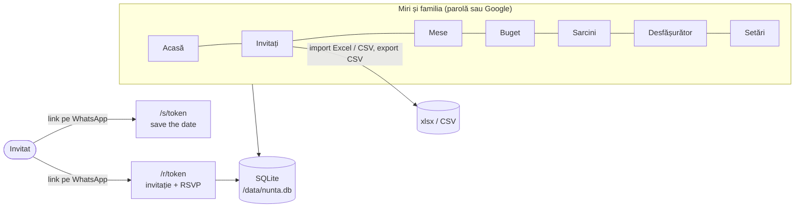
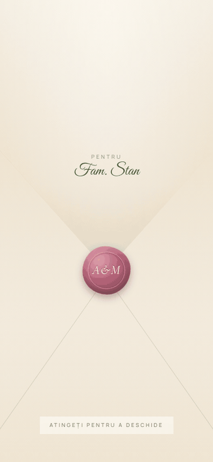
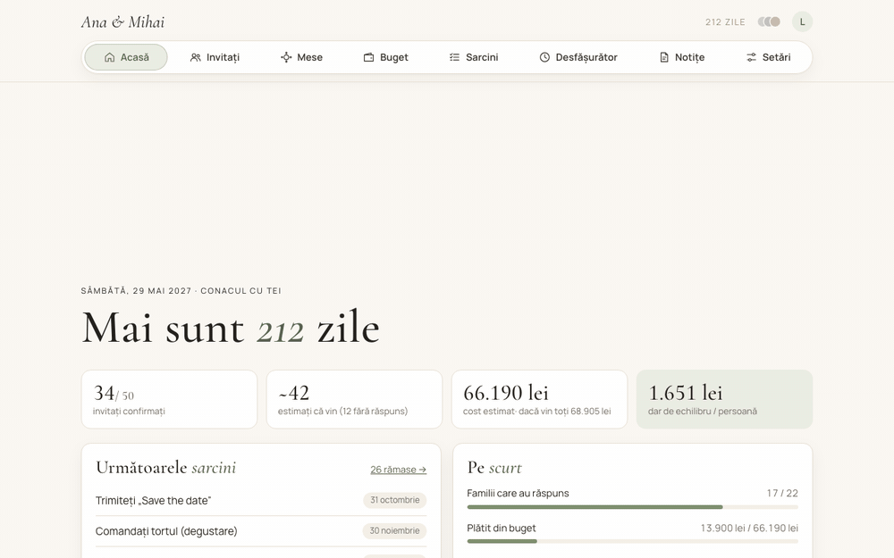

# planificator-nunta

> **Ce este:** un planificator de nuntă pe care îl instalați voi, făcut pentru nunțile din România:
> lista de invitați pe familii, invitație online cu confirmare (RSVP), așezarea la mese, bugetul cu
> darul de echilibru, sarcinile cu termene și desfășurătorul zilei. Înlocuiește tabelul Excel cu
> 15 foi, cu mai puține ecrane. Datele stau la voi, într-un singur fișier.

| | |
|---|---|
| **Pentru cine** | Miri și familie (nași, părinți), cu roluri: admin, editor, doar citire |
| **Invitați** | Fără cont: fiecare familie primește un link privat (WhatsApp, SMS) |
| **Intrare** | Parolă pe rol, sau contul Google (opțional) |
| **Tehnic** | SvelteKit 3 (Svelte 5), TypeScript, `node:sqlite` (fără module native), adapter-node |
| **Date** | Un fișier SQLite + poza și muzica voastră, într-un volum Docker |
| **Cost** | 0 lei pe calculatorul vostru; un VPS mic (~25 lei/lună) dacă îl puneți online |
| **Licență** | MIT |



## Cum arată

Cu datele demo (`DEMO_DATA=true`): o nuntă inventată, fără poză de fundal încărcată.

| Ce primește un invitat, pe telefon | Ce văd mirii |
|---|---|
|  |  |

## Ce face

1. **Acasă**: câte zile mai sunt, câți au confirmat, costul estimat, darul de echilibru și
   următoarele sarcini.
2. **Invitați**: invitații pe familii, din partea mirelui sau a miresei, pe categorii (miri, nași,
   familie, prieteni, colegi, cunoștințe) și subcategorii (părinți, frați, veri, unchi/mătuși,
   serviciu, facultate…), cu observații și „TBD" pentru cei încă nesiguri. Importă direct fișierul
   `.xlsx` (inclusiv familii pe celule unite) sau CSV; *Înlocuiește lista* sincronizează cu fișierul.
3. **Invitația și confirmarea**: fiecare familie are două linkuri private. *Save the date* arată
   numele, data, câte zile mai sunt și „Adaugă în calendar" (Google, Apple, Outlook). *Invitația* se
   deschide dintr-un plic cu sigiliu și monograma voastră, cu muzica voastră dacă ați încărcat-o:
   numărătoare inversă, cununia și petrecerea cu hartă și Waze, programul zilei și formularul de
   confirmare (vine / nu vine, meniu, alergii, un gând pentru miri).
4. **Mese**: planul sălii dintr-un șablon (mese rotunde, masa mirilor, ringul, formația), pe care le
   mutați unde sunt în realitate, cu o poză a sălii dedesubt. Așezați invitații cu două atingeri:
   persoana sau familia, apoi masa. Se tipărește ca plan plus lista pe mese.
5. **Buget**: costuri fixe, per adult sau per copil, înmulțite cu numărul estimat de invitați
   (procentul de prezență din Setări). Arată soldul estimat (contribuția nașilor și părinților plus
   darul mediu), **darul de echilibru** și soldul real din darurile primite.
6. **Sarcini**: 35 de sarcini tipice pentru o nuntă în România (biserică, Starea Civilă, analize
   prenupțiale…), cu termene calculate din data nunții.
7. **Desfășurător**: ziua nunții pe ore (machiaj, pregătiri, cununie, ședința foto, petrecere). Când
   întârziați, *Mută acest moment și tot ce urmează*. Momentele bifate apar și pe invitație.
8. **Notițe** (doar admin): notițe cu un mic calculator de cantități (7 trandafiri × 21 vaze).

## Cerințe

- **Docker** cu Compose v2 (Docker Desktop, OrbStack, Colima sau Docker pe un VPS Linux), sau
- **Node ≥ 24** pentru a rula fără container (dezvoltat pe Node 26).

## Pornire rapidă

### Pe calculatorul vostru

```bash
git clone https://github.com/teodorio95-portofolio/planificator-nunta.git
cd planificator-nunta
make env          # creează .env din .env.example
# în .env: ADMIN_PASSWORD=o-parola-lunga (minim 8 caractere)
make up           # http://localhost:3000
```

Fără `make`: `cp .env.example .env`, completați parola, apoi `docker compose up -d`.

Vreți doar să vă uitați? Puneți `DEMO_DATA=true` în `.env` înainte de prima pornire: baza goală se
umple cu o nuntă inventată (Ana și Mihai, 22 de familii, 50 de invitați, mesele aranjate, un buget).
Pentru nunta voastră, porniți pe o
bază goală (`docker compose down -v` șterge volumul cu tot cu date).

### Online, cu domeniul vostru (HTTPS automat)

Pe un VPS cu Docker, cu domeniul (de ex. `nunta.exemplu.ro`) îndreptat spre server și porturile 80
și 443 deschise:

```bash
make env          # apoi în .env: ADMIN_PASSWORD=… și DOMAIN=nunta.exemplu.ro
make up-https     # Caddy cere singur certificatul Let's Encrypt
```

### Primii pași în aplicație

1. **Setări**: numele mirilor, data, locația, biserica cu ora (de ex. „Biserica Sf. Nicolae, ora 15:00"),
   termenul de confirmare, moneda și procentul estimat de prezență.
2. **Setări → Invitația**: o poză de fundal (voi sau locația) și, opțional, muzica.
3. **Invitați**: importați lista din Excel sau adăugați familiile.
4. Din pagina fiecărei familii, trimiteți linkul de save the date sau de invitație pe WhatsApp.

## Intrarea în aplicație

Cel mai simplu: câte o parolă comună pe rol, în `.env`.

| Rol | Parolă | Poate |
|---|---|---|
| Admin | `ADMIN_PASSWORD` | tot, plus Setări, backup, Notițe, dispozitivele conectate |
| Editor | `EDITOR_PASSWORD` | să modifice invitați, mese, buget, sarcini; export CSV |
| Doar citire | `READER_PASSWORD` | să vadă tot în afară de Setări și Notițe; poate adăuga sarcini |

O parolă schimbată (și containerul repornit) deconectează pe toți cei care intraseră cu ea. După 10
parole greșite de la aceeași adresă, încercările se opresc pentru un sfert de oră.

**Google (opțional)**: creați în Google Cloud un client OAuth de tip *Web application*, cu redirect URI
`https://domeniul-vostru/auth/google/callback`, și completați `GOOGLE_CLIENT_ID`, `GOOGLE_CLIENT_SECRET`
și listele `ADMIN_EMAILS` / `EDITOR_EMAILS` / `READER_EMAILS`. Adminul poate adăuga și din Setări
conturi doar cu citire. Merge pe lângă parole.

**Fără nicio parolă și fără Google aplicația rămâne blocată** (afișează ce trebuie configurat).
`AUTH_DISABLED=true` o deschide oricui, ca admin: doar pentru încercări pe calculatorul vostru.

## Comenzi

```text
make help         toate comenzile
make up / down    pornește / oprește containerul (datele rămân în volumul nunta-data)
make up-https     pornește în spatele Caddy, cu HTTPS pentru DOMAIN
make logs         jurnalul aplicației
make backup       copie a bazei, a pozei și a muzicii în data/backups/<data>/
make dev          server de dezvoltare pe http://localhost:5173 (deschis, ca admin)
make demo         server de dezvoltare pe o bază cu nunta inventată
make test check   teste și verificarea tipurilor
```

## Importul listei de invitați

**Invitați → Import din CSV / Excel**, un rând per persoană. Coloane recunoscute: `familie` /
`familii`, `nume` / `invitat` (obligatoriu), `din partea` (mire / mireasă), `categorie`,
`subcategorie`, `observatii`, `tbd`, `copil` (da), `meniu`, `restrictii`, `telefon`. Pentru CSV,
separatorul e `,` sau `;`.

Fără coloana `familie`, familiile se deduc din ordine: oamenii consecutivi cu același nume de familie
și aceeași parte, rândurile „Soție Andrei" / „Iubit Ana" lângă persoana de deasupra, „Copil …" ca
copii. Reimportul aceluiași fișier nu dublează nimic.

## Structură

```text
src/
  lib/
    access.ts            roluri și ce poate fiecare (testat)
    calc.ts              calculele: prezență, buget, dar de echilibru, termene (testat)
    guests.ts, csv.ts    import și deducerea familiilor (testat)
    invitation.ts        numărătoarea, monograma, iconițele programului (testat)
    Plic.svelte          plicul invitației, cu muzica
    server/
      db.ts              schema SQLite, migrări mici, setări
      auth.ts            parole pe rol, Google, sesiuni (testat)
      media.ts           poza de fundal și muzica încărcate din Setări
      demo.ts            nunta inventată pentru DEMO_DATA=true
  routes/
    (app)/               paginile mirilor: Acasă, invitati, mese, buget, sarcini, desfasurator, setari, notite
    r/[token]/           invitația cu confirmarea (publică, prin link)
    s/[token]/           save the date (public, prin link)
    media/[kind]/        poza și muzica, pentru paginile invitaților
compose.yaml             containerul, cu volumul nunta-data
compose.https.yaml       Caddy în față, cu HTTPS automat
```

## ⚠️ De reținut

- **Faceți backup** (`make backup` sau *Setări → Descarcă backup*). Nu există copie automată în altă
  parte; `docker compose down -v` șterge volumul cu toate datele.
- **Linkurile invitaților sunt cheile lor**: cine are linkul unei familii poate schimba răspunsul ei.
  Un link scăpat se înlocuiește din pagina familiei (*Generează link nou*).
- **Online, folosiți HTTPS** (`make up-https` sau propriul reverse proxy cu `PROTOCOL_HEADER` și
  `ADDRESS_HEADER`, cu portul aplicației doar pe `127.0.0.1`). Pe `http://` merge pe calculatorul
  vostru și în rețeaua de acasă.
- **Imaginea Docker** se publică în GHCR din CI la primul push pe `main`; până atunci, `make up` o
  construiește local din sursă.
- **Muzica și poza** trebuie să fie ale voastre sau să aveți dreptul să le distribuiți: ele se
  servesc public, oricui are un link de invitație.
- Interfața e doar în română, cu obiceiurile nunților de la noi (nași, dar, cununie religioasă).
